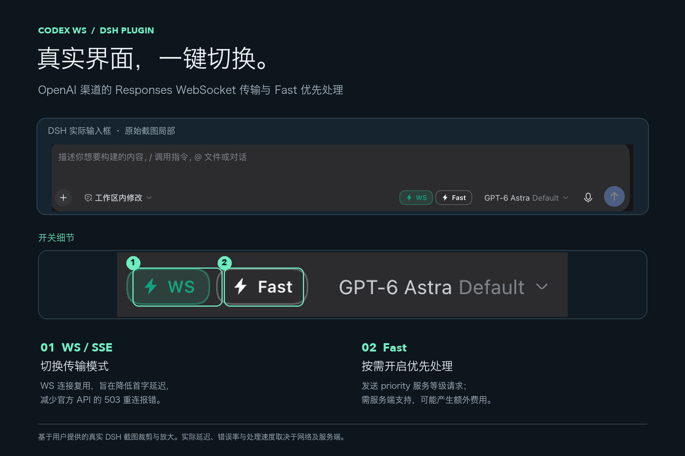

# dsh-codex-ws

让 DSH 里的 **OpenAI 与兼容第三方供应商的 GPT 模型走 Codex 风格的 Responses WebSocket 传输**（即 Codex CLI `supports_websockets = true` 的 "WS 模式"），而不是 SSE 流式。不注册额外模型渠道：按钮在当前所选渠道原地生效，请求默认使用该渠道自己的接口地址和凭据。第三方渠道按 GPT 模型 ID 识别（包括 `openai/gpt-*` 等带命名空间的 ID），同一渠道中的非 GPT 模型不会显示按钮。

## 它做什么

- **不新增模型渠道**。插件拦截 harness 的 `llm/stream` 水流：传输开关为 websocket / auto 时，OpenAI 渠道和兼容第三方渠道的 GPT 请求改走该渠道 `<baseURL>/responses` 的 Codex 风格传输；切回 SSE 且 Fast 关闭时原样放行给该渠道原有适配器。
  - **WS 模式**：`wss://<baseURL>/responses`，发送 `{ "type": "response.create", ... }` 后接收与 SSE 完全相同的 Responses 事件流；连接按池复用（干净结束后保留 3 分钟，50 分钟强制换新）。
  - **SSE 模式**：Fast 关闭时不拦截，走 DSH 当前渠道原有的流式请求（auto 模式下的回退则是普通 `POST /responses` + `stream: true` 打到同一中转站）。
  - 拦截层复刻了适配器边界的投影（文件 → 可读路径句柄、图片 → 文本占位、developer 消息丢弃、deferLoading 工具声明展开），WS 路径目前仅发送文本，不会把图片原始内容发送给模型；不能视为与原生多模态适配器完全等价。
- **默认继承 DSH 当前所选渠道的接口地址与凭据**：通过 `llm/listConfigurableProviders` 定位请求所属路由的设置命名空间与 profile 路径，读取其 `baseURL`（缺省用渠道默认地址），`apiKeyEnv` 凭据引用经 credentials 服务解析。每次请求重新读取，渠道配置改动即时生效；第三方渠道不会回退借用 OpenAI 渠道的地址或 Key，不读取本地 Codex CLI 配置，也没有写死的中转地址。
- 插件的 `baseURL` / `apiKey` / `apiKeyEnv` / `envFile` 留空即可继承。显式填写任意一项会进入独立覆盖模式，必须同时提供接口地址和 Key，不会与 DSH 的地址或凭据混用。
  - 覆盖模式 Key 顺序：`apiKey` → `envFile` 中对应变量 → 显式指定的 `apiKeyEnv` 环境变量。
  - `apiKeyEnv` 默认留空；仅配置 `envFile` 时默认读取文件中的 `OPENAI_API_KEY`。不会自动使用进程中的 `OPENAI_API_KEY`。
  - 不再自动沿用 `~/.codex/config.toml`；若要使用同一服务，请在 DSH OpenAI 渠道中配置，或显式提供插件覆盖配置。
  - 升级后若旧配置保存了 `apiKeyEnv: OPENAI_API_KEY`，请清空该字段及其他覆盖项以启用继承。
  - 继承模式下渠道未配置或凭据无法解析时请求明确报错（`INVALID_CONFIGURATION`），不会退回其他端点或凭据。
- 输入框右侧、模型选择器旁的 **WS / SSE** 小按钮实时切换传输模式（下一次模型请求生效），选择持久化在 `$DSH_HOME/codex-ws/state.json`。**OpenAI 渠道，以及兼容第三方渠道的 GPT 模型均显示 WS / SSE 和 Fast 按钮**。切换供应商或同一供应商内的模型时即时更新；新会话按默认供应商与模型判断。按钮提示显示当前渠道对应的端点。
- 第三方渠道支持 `llm-pi-ai` 中显式配置为 `openai-responses` 或 `openai-completions`、使用 `apiKeyEnv` 凭据引用的渠道。OAuth / Codex 登录、Anthropic 原生协议及带自定义请求头的渠道仍由原有适配器处理。
- 开启 WS 或 Fast 后，第三方服务必须支持对应的 Responses 接口、WebSocket 或 priority 服务等级，按钮出现不代表服务端一定支持这些能力；SSE 且 Fast 关闭时仍使用渠道原有协议。

### Fast 模式

WS / SSE 按钮旁新增独立 **Fast** 按钮，默认关闭，开启后高亮。开关与传输模式分别保存，全局影响所有符合条件的 OpenAI / GPT 请求，从下一次模型请求生效，重启后保留。

- 开启时发送 `service_tier: "priority"`，不改变模型、推理强度或输出长度；是否支持、实际速度和额外费用由服务端决定。
- WS / auto 及 auto 回退 SSE 均保留该参数。**SSE + Fast 由插件发起 Responses 请求，默认继承当前所选渠道的端点与凭据**，并继承插件的仅文本投影限制。关闭 Fast 后 SSE 恢复原样放行。
- WS / auto / SSE + Fast 配置不完整时明确报错，不静默丢弃优先处理参数。切换 Fast 后增量 WS 请求配置指纹改变，自动全量发送。
- 离线验证：`node test/fast.mjs`（不调用真实 API）。

## 安装

可运行 `npm pack dsh-codex-ws@1.4.0 --registry=https://registry.npmjs.org` 获取安装包，在 DSH 插件管理中安装本地包；或克隆仓库后从本地目录安装。安装后刷新插件和界面。

## 界面预览

图片基于真实 DSH 截图裁剪与放大。WS 连接复用旨在降低首字延迟、减少官方 API 的 503 重连报错；实际效果取决于网络与服务端。Fast 请求优先处理，需服务端支持，可能额外计费。

### v1.4.0 更新说明

- **支持第三方供应商的 GPT 模型**：不再把按钮和请求拦截写死为 `openai` 渠道，兼容 `llm-pi-ai` 中配置为 `openai-responses` / `openai-completions` 的渠道。
- 请求使用**所属渠道自己的接口地址与凭据**，不会借用 OpenAI 渠道的地址或 Key；第三方渠道凭据缺失时明确报错，不静默回退。
- 按钮按 GPT 模型 ID 识别（支持 `openai/gpt-*` 等命名空间），同一渠道内的非 GPT 模型不显示按钮；切换供应商或模型时即时更新，新会话按默认供应商与模型判断。
- 按钮提示显示当前渠道对应的端点；同一供应商内切换模型也会刷新显示。
- 新增 `test/providers.mjs` 多供应商回归测试，覆盖凭据隔离、协议识别、SSE / Fast 行为与公开状态脱敏。
- 原有 OpenAI 渠道行为、开关持久化与增量 WS 续传保持不变。

### v1.3.2 更新说明

- 更新中英文插件描述，说明首字延迟、503 重连报错与可选 Fast 模式。
- 添加真实 DSH 界面说明图及 `screenshots.json`，供插件市场采集展示。
- 本次仅更新描述、文档和展示素材，不改变运行时行为。

### v1.3.1 升级说明

- 默认继承 DSH OpenAI 渠道的接口地址和凭据，每次请求重新读取渠道配置。
- 移除本地 Codex CLI 配置与内置中转地址回退；显式覆盖必须成对提供地址和 Key，避免混用端点与凭据。
- **从旧版升级**：若插件中保存了 `apiKeyEnv: OPENAI_API_KEY`，请清空它及其他覆盖项以启用继承；如需独立覆盖，请同时配置 `baseURL` 和 Key。
- 配置不完整时，WS / auto / SSE + Fast 明确报错；SSE 且 Fast 关闭仍由原生 OpenAI 适配器处理。

## npm 发布维护

仓库使用 `.github/workflows/publish.yml`，在推送 `v*` 标签时校验标签与版本一致、运行离线测试，再通过 GitHub Actions OIDC 发布到 npm。不配置长期 `NPM_TOKEN`。手动重试时必须选择对应版本标签，分支上的手动运行不会发布。

首次发布需要维护者通过 `npm login --registry=https://registry.npmjs.org` 登录并执行 `npm publish --access public` 创建包。随后在 npm 包 Settings → Trusted Publisher 中选择 GitHub Actions：

- Organization or user：`kiritoko1029`
- Repository：`dsh-codex-ws`
- Workflow filename：`publish.yml`（不含目录）
- Environment name：留空
- Allowed actions：允许 `npm publish`

后续升级版本、提交并推送匹配版本的标签即可自动发布。不要再次发布已存在的 npm 版本。Trusted Publisher 配置完成不等于验证成功，应以一次实际 OIDC 发布成功为准；新绑定若有到期提示，按 npm 要求及时完成首次验证。

参考：[npm Trusted Publishing 文档](https://docs.npmjs.com/trusted-publishers/)。

## 使用

1. 确认 OpenAI 或兼容第三方渠道已配置好接口地址与 Key；模型选择器里选该渠道的 GPT 模型。
2. 模型选择器旁会出现 WS / SSE 按钮：默认即 WS 模式（可配置）；点一下切回 SSE 流式，再点切回 WS。
3. 默认无需重复填写地址和 Key。插件配置（设置 → 插件 → Codex WS → 配置）可改：`transport`（websocket / sse / auto，auto = WS 连接失败自动回退流式）、`baseURL`、`apiKey`、`apiKeyEnv`、`envFile`、超时等。

## 说明

- **v1.2.0 增量 WS**：首次全量发送；同一会话、同一连接上，只有当前历史严格延续上次输入与已完成输出，且 instructions / tools / model 等请求配置未变时，才使用 `previous_response_id` 并只发送新增 input。仍保持 `store: false`。
- 连接按完整凭据哈希、端点、会话隔离；并发调用独占连接，不共享正在执行的续传状态。空闲 3 分钟或连接总寿命 50 分钟后关闭，全局最多保留 32 个空闲连接。
- 历史压缩、编辑、分支、模型或提示/工具配置变化、连接丢失时自动使用全量。明确收到上一响应不存在错误、且还没有输出时，只允许一次新连接全量重试；已发送后遇到普通网络错误不会盲目重发。取消、未完成、失败结果不保存续传状态。
- 工具 schema 和 instructions 仍随每次请求发送；优化减少历史 input 上传量，不减少模型实际上下文长度，也不保证同等比例的计费下降。DSH 若每一步改写早期历史或系统提示，会触发保守全量发送。
- 验证：`node test/continuation.mjs` 为离线边界测试；`bun test/continuation-live.mjs` 使用合成消息验证中转站续传与实际发送字节（会产生少量 API 调用）。一次实测为 14,242 → 511 字节，第二轮正确回忆第一轮标记；真实降幅取决于历史与固定请求配置大小。
- Key 只在 Host 侧使用，浏览器端只拿到 `/codex-ws/state` 返回的开关状态与端点地址（不含 Key）。
